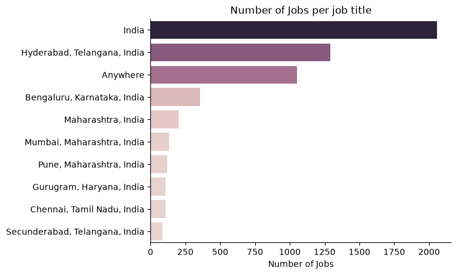
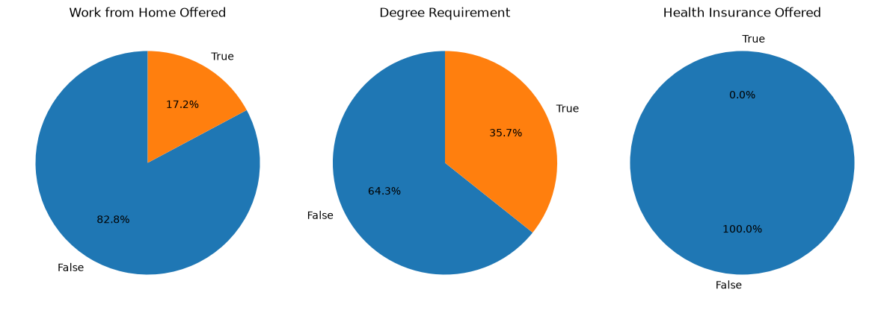
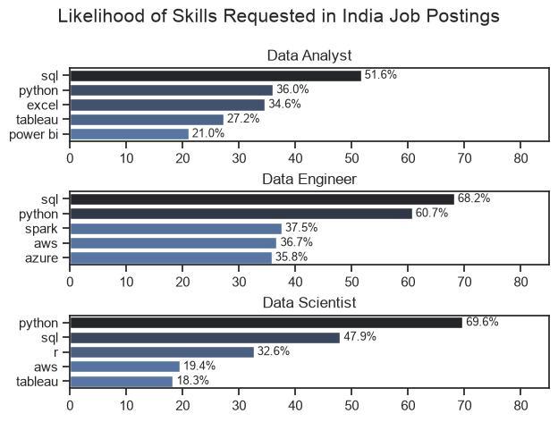
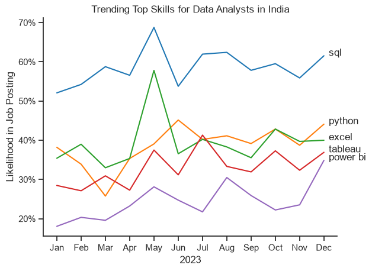
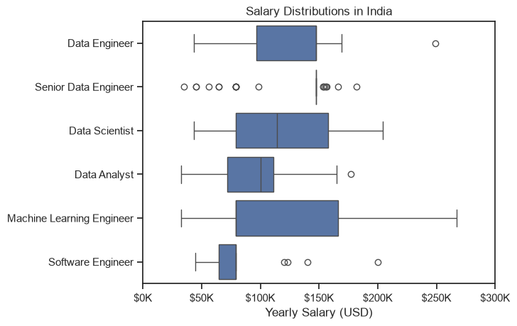
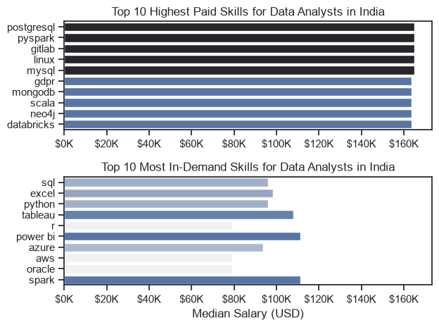
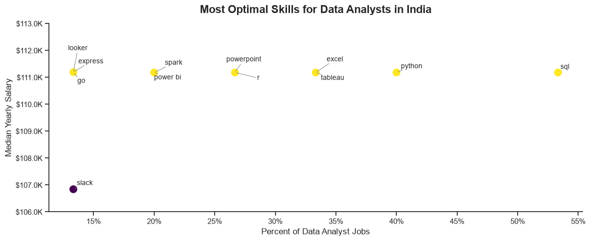
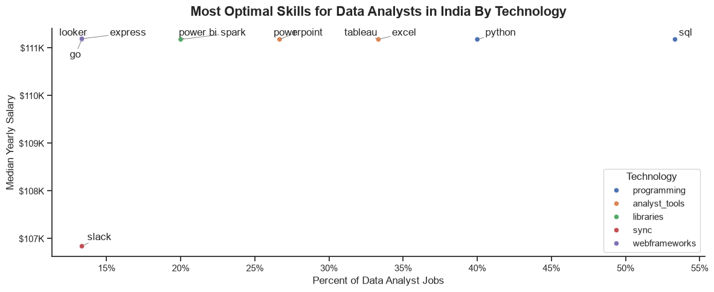

# Which Skills Should an Aspiring Data Analyst Learn? A Job-Market Analysis (India)

A five-notebook Python project that works through a real analytics question from start to finish: **what should an aspiring Data Analyst in India learn first, and what can they expect to earn?**

I built it to practise the full analyst workflow: loading and cleaning messy, nested data, reshaping it for analysis, choosing sensible metrics, and turning the results into a clear answer. The emphasis is on *how* the problem was approached and solved, so each section covers the method, the problems I ran into, and the decisions I made.

> The analysis uses a large public collection of job postings. Dataset details are intentionally left out of this write-up; the focus is on the techniques.

---

## Table of Contents
1. [Problem Statement & Objectives](#problem-statement--objectives)
2. [Technology Stack](#technology-stack)
3. [Project Workflow at a Glance](#project-workflow-at-a-glance)
4. [Data Cleaning & Preprocessing](#data-cleaning--preprocessing)
5. [Transformation & Analysis Techniques](#transformation--analysis-techniques)
6. [Notebook Walkthrough with Visuals](#notebook-walkthrough-with-visuals)
7. [Problems Encountered & How I Solved Them](#problems-encountered--how-i-solved-them)
8. [Key Technical Decisions](#key-technical-decisions)
9. [Key Insights](#key-insights)
10. [Limitations & What I Would Do Next](#limitations--what-i-would-do-next)
11. [Repository Structure & Setup](#repository-structure--setup)

---

## Problem Statement & Objectives

A beginner faces an overwhelming skills list: SQL, Python, Excel, Tableau, Power BI, R, cloud tools, and more. The goal was to replace guesswork with evidence by answering five connected questions:

| # | Question | Notebook |
|---|----------|----------|
| 1 | What does the Data Analyst job market in India look like? | `1_EDA_Intro` |
| 2 | Which skills are most demanded across the top data roles? | `2_Skills_Demand` |
| 3 | How does demand for the top analyst skills move over 2023? | `3_Skills_Trend` |
| 4 | How well do roles and individual skills pay? | `4_Salary_Analysis` |
| 5 | Which skills balance high demand with high pay, and what kind of technology are they? | `5_Optimal_Skills` |

## Technology Stack

| Area | Tools actually used in the notebooks |
|------|--------------------------------------|
| Language / environment | Python, Jupyter Notebook |
| Data loading | `datasets` (load into a pandas DataFrame) |
| Data manipulation | `pandas`: boolean filtering, `explode`, `groupby` + `agg`, `pivot_table`, `merge`, `value_counts`, `dropna`, `drop_duplicates`, `sort_values`, `dt` accessor, `apply` / lambda |
| Parsing | `ast.literal_eval` (string → list / dict) |
| Visualisation | `matplotlib` (subplots, `FuncFormatter`, `PercentFormatter`), `seaborn` (`barplot`, `boxplot`, `lineplot`, `scatterplot`, `set_theme`, `despine`) |
| Plot polish | `adjustText` for non-overlapping scatter labels |

## Project Workflow at a Glance

```
Raw postings
   │  load → parse types (dates, stringified lists)
   ▼
Scope the question (country, role, salary availability)
   │
   ▼
Reshape: explode list-valued skill column → one row per (posting, skill)
   │
   ▼
Aggregate: counts, medians, monthly pivots
   │
   ▼
Normalise: convert counts to % of postings (fair comparison)
   │
   ▼
Enrich: join skills to a technology-category lookup built from nested data
   │
   ▼
Visualise → interpret → recommendation
```

---

## Data Cleaning & Preprocessing

All five notebooks begin with the same preparation block, then apply task-specific filtering.

### 1. Load and fix data types
```python
df = dataset['train'].to_pandas()

df['job_posted_date'] = pd.to_datetime(df['job_posted_date'])
df['job_skills'] = df['job_skills'].apply(lambda x: ast.literal_eval(x) if pd.notna(x) else x)
```
- **Dates:** the posting date arrived in a form unsuitable for time analysis, so I converted it to `datetime` to be able to extract months.
- **Skills:** the skills column was stored as a *string that looks like a list* (`"['sql', 'python']"`). Counting on it directly would treat each whole string as one skill. `ast.literal_eval` safely converts it into a real list. The `pd.notna` guard leaves missing values untouched instead of crashing.

### 2. Inspect as I go
I checked each step with `.sample()`, `.head()` and `.value_counts()`, for example sampling after each filter and after `explode` to confirm the shape was what I expected.

### 3. Scope the data per question
| Notebook | Scope |
|----------|-------|
| 1 | India **and** standardised role = Data Analyst |
| 2 | India, all roles |
| 3, 5 | India **and** exact posting title = "Data Analyst" |
| 4 | India, rows with a reported salary (`dropna(subset=['salary_year_avg'])`) |
| 5 | Same as 3, then drop rows without a salary |

`.copy()` is used after filtering in notebooks 3 and 5 so that later column additions don't trigger pandas' `SettingWithCopy` warnings.

### 4. Handle missing values deliberately
- **Salary** is only reported for a minority of postings. Rather than imputing, I **dropped** rows with no salary *only* for the salary notebooks (4 and 5), and kept them for demand analysis (2 and 3) where salary isn't needed. This avoids discarding useful data unnecessarily.
- **Skills:** postings with no skills become a single `NaN` row after `explode`. Those rows fall out of grouped skill counts naturally, but they remain in the posting totals used as denominators.

---

## Transformation & Analysis Techniques

| Technique | What it does | Used in |
|-----------|--------------|---------|
| `explode` | Converts one-row-per-posting into one-row-per-(posting, skill) so skills can be counted | 2, 3, 4, 5 |
| `groupby().size()` / `.agg(['count','median'])` | Skill counts by role; count + median salary by skill | 2, 4, 5 |
| Merge with posting totals | Attaches each role's total postings so counts can become percentages | 2 |
| `pivot_table` (month × skill) | Builds the monthly demand matrix, columns ordered by overall frequency | 3 |
| Row-wise division by monthly totals | Normalises monthly counts into "likelihood in a posting" | 3 |
| Median aggregation | Robust central measure for skewed salary data | 4, 5 |
| Demand threshold (`skill_percent > 7`) | Filters out rare skills so the chart shows meaningful ones | 5 |
| Nested-dict flattening + `merge` | Builds a skill → technology-category lookup and joins it to the results | 5 |

---

## Notebook Walkthrough with Visuals

### 1. Exploring the market (`1_EDA_Intro`)
Profiled Data Analyst postings in India by location, and by whether they offer remote work, mention a degree requirement, or list health insurance.



*Hyderabad, Telangana is the largest named city (1,289 postings), followed by Bengaluru (355), Mumbai (133), Pune (119), Gurugram (108) and Chennai (106). "India" (2,056) and "Anywhere" (1,052) are generic location values, which shows the location field needs normalising before any city-level conclusions.*



*17.2% of postings are work-from-home, 35.7% mention no degree requirement, and 0.0% flag health insurance.*

### 2. Skill demand by role (`2_Skills_Demand`)
Exploded skills, counted them by role, then merged in each role's total postings to compute the **percentage of postings** requesting each skill. Raw counts alone would favour roles that simply have more postings.



| Role | Top skills (% of that role's postings) |
|------|----------------------------------------|
| Data Analyst | SQL 51.6, Python 36.0, Excel 34.6, Tableau 27.2, Power BI 21.0 |
| Data Engineer | SQL 68.2, Python 60.7, Spark 37.5, AWS 36.7, Azure 35.8 |
| Data Scientist | Python 69.6, SQL 47.9, R 32.6, AWS 19.4, Tableau 18.3 |

*SQL is common to all three roles. Analysts lean on spreadsheet and BI tools, engineers on big-data and cloud tooling, scientists on Python and R.*

### 3. Skill trends through 2023 (`3_Skills_Trend`)
Extracted the posting month, pivoted skills by month, and divided by monthly posting totals so that months with more postings don't distort the trend.



*SQL stays on top all year (about 52–69%). Power BI climbs from about 18% in January to about 35% in December. Excel spikes to about 58% in May, a month with only 64 postings (the lowest of the year), so I read that spike as small-sample noise rather than a real shift.*

### 4. Salary analysis (`4_Salary_Analysis`)
Compared salary distributions for the six most common salaried roles (boxplot, ordered by median), then compared the highest-paid skills with the most in-demand skills.



*Ranked by median: Data Engineer, Senior Data Engineer, Data Scientist, Data Analyst, Machine Learning Engineer, Software Engineer. Ranges overlap heavily; ML Engineer shows the widest spread.*



*The top-paid skills (e.g. PostgreSQL, PySpark, GitLab at $165,000) each rest on only 1 to 6 postings, whereas the common skills (SQL 46 postings, Excel 39, Python 36) pay medians of about $96K–$111K. Rare and high-paying is not the same as reliable.*

### 5. Optimal skills (`5_Optimal_Skills`) — latest version
Computed each skill's posting count, median salary and percent of salaried Data Analyst postings, kept skills above a **7% demand threshold**, and plotted demand against pay. The notebook then goes one step further: it flattens a nested "technology type" column into a skill → category lookup and merges it in, so the same chart can be coloured by technology.





*SQL (53.3% of salaried analyst postings), Python (40.0%), Tableau and Excel (33.3% each) are the most frequent. Their medians are almost identical ($111,175), so **demand, not pay, is what separates them**. Coloured by category, the most frequent skills are programming (SQL, Python) and analyst tools (Tableau, Excel, PowerPoint).*

---

## Problems Encountered & How I Solved Them

| Problem | How I approached it |
|---------|---------------------|
| Skills stored as text, not lists | Parsed with `ast.literal_eval`, guarded for missing values |
| One row per posting made skill counting impossible | `explode` to one row per (posting, skill) |
| Roles have very different posting volumes, so counts mislead | Converted counts to percentages of each role's postings |
| Monthly posting volume varies a lot (64 to 204 per month) | Normalised monthly counts by monthly totals; flagged low-volume spikes as unreliable |
| Salary has outliers and is mostly missing | Used **median**, dropped missing salaries only where salary was needed, reported sample sizes |
| Rare skills dominate "highest-paid" rankings | Compared against a demand view side by side; applied a demand threshold in the optimal-skills analysis |
| Skill labels overlapped on the scatter plot | Used `adjustText` with tuned spacing and connector lines |
| Skills lacked a category | Built a lookup by flattening and de-duplicating the nested technology column, then merged it onto the results |
| Axis units unreadable | Custom formatters for `%` and `$K` |

## Key Technical Decisions

- **Percentages over counts** whenever groups differ in size (roles in notebook 2, months in notebook 3).
- **Median over mean** for salary, because a few extreme values would otherwise distort it.
- **Scope each notebook to its own question** and reload from the same preparation block, so notebooks are independent and reproducible.
- **Show sample sizes** next to salary results so the reader can judge how much weight to give them.
- **Add the technology dimension** in the final notebook to move from "which skills" to "which kinds of tools".

## Key Insights

1. **Learn SQL first.** It is the most requested skill for Data Analysts (51.6%) and Data Engineers (68.2%), and second for Data Scientists (47.9%).
2. **Then add Python, Excel and one BI tool (Tableau or Power BI).** These complete the analyst top five, and Power BI demand rose through late 2023.
3. **Hyderabad and Bengaluru** are the main named hiring cities in this data.
4. **Pay is not a strong differentiator among common skills** in the salaried sample: the leading skills share almost the same median, so prioritise by demand.
5. **Remote work and benefits signals are weak** in postings (17.2% remote, 0% health insurance flagged).

## Limitations & What I Would Do Next

These are limitations of the data and of the notebooks as written. I have left the analysis unchanged and listed them here as follow-ups.

- **Small salary sample.** The optimal-skills analysis rests on only 15 salaried "Data Analyst" postings, and most skills share the same median, which suggests a few postings drive every value. Conclusions about pay are indicative only.
- **Notebook 4 filter.** In its skill-salary section, `df_DA_IN` is reassigned from the all-roles salaried frame, so those skill medians cover every salaried India role, not only Data Analysts, despite the chart titles. This is the first thing I would fix.
- **Notebook 5 technology chart.** Skills with identical median and percent (for example Power BI and Spark) plot on the same point, so some markers are hidden. The text labels in that cell are drawn from the pre-merge table, so they do not always sit next to the matching colour.
- **Inconsistent "Data Analyst" definitions** (standardised role in notebooks 1–2, exact title in 3 and 5).
- **Unnormalised text fields:** location values mix country, state and city, and the same company can appear under multiple spellings.
- **Single year** of data; low-volume months are volatile.
- **Next steps:** normalise locations and company names, fix the notebook 4 filter, extend the salary sample, and add a statistical test for the month-to-month trend.

## Repository Structure & Setup

```
Project/
├── 1_EDA_Intro.ipynb
├── 2_Skills_Demand.ipynb
├── 3_Skills_Trend.ipynb
├── 4_Salary_Analysis.ipynb
├── 5_Optimal_Skills.ipynb
├── images/        # charts exported from the notebooks
└── README.md
```

```bash
python -m venv .venv && source .venv/bin/activate
pip install pandas datasets matplotlib seaborn adjustText jupyter
jupyter notebook
```

Run the notebooks in numeric order; each starts with its own loading and preparation cell.
